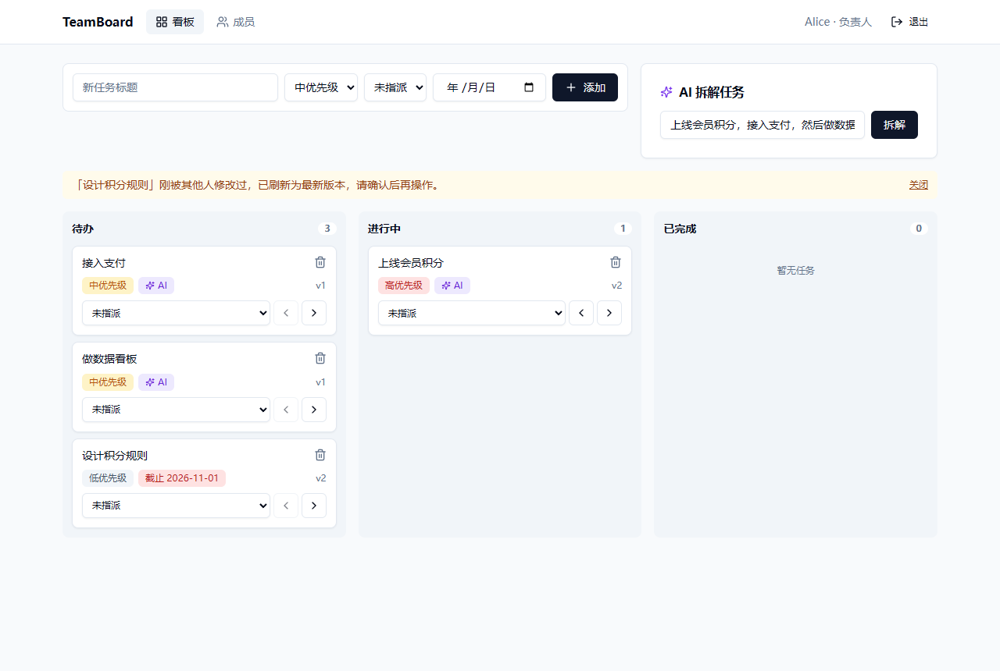

# 综合项目：TeamBoard 团队任务看板

八讲内容的综合实战：一个多租户的团队任务看板，带 AI 任务拆解。选题对应 README 中的"📋 团队协作工具"，同时覆盖"🤖 AI 助手"和"📊 权限 + 多租户"。



## 功能

- 注册即创建团队工作区（多租户），负责人可以添加成员（RBAC）
- 三列看板：新建、指派、移动、删除任务，过期任务标红
- **乐观锁**：两人同时修改同一任务，后提交者收到 409，前端自动刷新为最新版本并提示
- **AI 拆解任务**：输入目标 → 模型返回结构化子任务 → 人工勾选确认 → 事务批量创建；模型不可用时自动降级为规则拆解
- 结构化日志（requestId 贯穿）、Prometheus 指标、健康检查、登录与 AI 接口限流

## 需求对照

| 综合项目要求                   | 实现位置                                                                               |
| ------------------------------ | -------------------------------------------------------------------------------------- |
| React + TypeScript + shadcn/ui | `web/`：Vite + React 18 + Tailwind + shadcn 风格组件 + Zustand + React Router          |
| Node.js REST API               | `api/src/routes`：Express 5 + Zod 校验 + JWT 鉴权 + RBAC                               |
| PostgreSQL                     | `api/src/db`：Drizzle ORM，迁移在 `api/drizzle/`，启动时自动执行                        |
| Docker 容器化 + CI/CD          | `api/Dockerfile`、`web/Dockerfile`、`docker-compose.yml`、`/.github/workflows/capstone.yml` |
| 至少一个 AI 功能模块           | `api/src/services/aiService.ts`：`generateObject` 结构化输出 + 超时 + 重试 + 规则兜底   |
| 日志与基础监控                 | `api/src/middleware/observability.ts`、`/metrics`、`monitoring/`（Prometheus + Grafana） |

各讲知识点在项目中的落点：

| 讲次      | 落点                                                                                    |
| --------- | --------------------------------------------------------------------------------------- |
| 1 React   | 看板页面、Zustand 持久化登录态、路由守卫                                                |
| 2 TS      | 前后端严格模式；`z.infer` 推导请求类型；`ApiError` 携带错误码                           |
| 3 Node    | 分层（routes / services / lib）、统一错误处理、bcrypt + JWT、`requireRole('owner')`     |
| 4 DB      | `workspace_id` 租户隔离、注册与批量创建用事务、`version` 乐观锁、`deleted_at` 软删除、关系查询避免 N+1 |
| 5 Docker  | 多阶段构建、只装生产依赖、`service_healthy` 启动顺序、命名卷持久化                       |
| 6 AI      | 结构化输出、人工确认后才落库、超时 + 重试 + 兜底、按用户限流控制成本                    |
| 8 生产    | pino 结构化日志、requestId、Prometheus 指标、健康检查、优雅停机、限流                   |

## 快速开始

### 方式一：不装 Docker（开发）

API 未配置 `DATABASE_URL` 时会自动使用 PGlite（WASM 版 PostgreSQL，数据存在 `api/.pglite`）。

```bash
cd api && pnpm install && pnpm dev     # http://localhost:8080
cd web && pnpm install && pnpm dev     # http://localhost:5173（/api 代理到 8080）
```

需要 Node.js 20+。打开 http://localhost:5173 → "创建工作区"注册即可。

### 方式二：Docker 一键启动

```bash
cp .env.example .env                   # 至少填写 JWT_SECRET（openssl rand -hex 32）
docker compose up -d --build           # http://localhost:8000

# 加上监控：Prometheus http://localhost:9090，Grafana http://localhost:3001（admin / admin，已预置 TeamBoard 面板）
docker compose --profile monitoring up -d --build
```

### 启用真实 AI

在 `api/.env`（本地）或 `.env`（Docker）中配置任意 OpenAI 兼容接口：

```bash
OPENAI_API_KEY=sk-xxx
OPENAI_BASE_URL=https://api.deepseek.com/v1   # 官方 OpenAI 可留空
OPENAI_MODEL=deepseek-chat
```

不配置时 AI 面板会显示"已使用规则兜底"，功能照常可用。

## 测试

```bash
cd api && pnpm test
```

集成测试跑在内存 PGlite 上，不需要 Docker 和网络，覆盖：注册登录、参数校验、RBAC、跨租户访问、乐观锁冲突、软删除权限、AI 兜底与批量事务、健康检查与指标。

## API

| 方法   | 路径                 | 说明                                         |
| ------ | -------------------- | -------------------------------------------- |
| POST   | `/api/auth/register` | 创建工作区 + 负责人（事务），返回 token      |
| POST   | `/api/auth/login`    | 登录                                         |
| GET    | `/api/me`            | 当前用户与工作区                             |
| GET    | `/api/members`       | 工作区成员                                   |
| POST   | `/api/members`       | 添加成员（仅负责人）                         |
| GET    | `/api/tasks`         | 任务列表（含负责人，单条 SQL）               |
| POST   | `/api/tasks`         | 新建任务                                     |
| POST   | `/api/tasks/batch`   | 批量新建（事务）                             |
| PATCH  | `/api/tasks/:id`     | 更新，需带 `version`，冲突返回 409 和最新数据 |
| DELETE | `/api/tasks/:id`     | 软删除（创建者或负责人）                     |
| POST   | `/api/ai/breakdown`  | AI 拆解目标，只返回建议不落库                |
| GET    | `/api/health`        | 健康检查（数据库）                           |
| GET    | `/metrics`           | Prometheus 指标（不经过 Nginx 对外暴露）     |

## CI/CD

工作流在仓库根目录 `.github/workflows/capstone.yml`，只在 `capstone/**` 变更时触发：

1. **test**：api / web 分别 `typecheck`、`test`、`build`
2. **image**：PR 只验证镜像能构建；推送到 `main` 时把镜像推到 GHCR（`ghcr.io/<owner>/<repo>/teamboard-api|web`，标签为 commit sha 和 `latest`）
3. **deploy**（可选）：仓库变量 `DEPLOY_ENABLED=true` 时，SSH 到服务器拉取本次 sha 的镜像并重启，最后做健康检查冒烟

服务器准备：把 `docker-compose.yml`、`monitoring/` 和 `.env` 放到 `/opt/teamboard`，执行一次 `docker login ghcr.io`（GHCR 镜像默认私有）。回滚 = 用上一个 sha 重新执行 deploy。

## 有意简化

| 简化                                   | 何时升级                                                        |
| -------------------------------------- | --------------------------------------------------------------- |
| 单 Access Token（8 小时），存 localStorage | 需要无感续期 / 更高安全性时改为双 Token 轮换 + httpOnly Cookie（见 `prototype/03-node-auth.html`） |
| 限流计数在进程内存                     | 多实例部署时换 `rate-limit-redis`                               |
| 单模型 + 规则兜底                      | 需要高可用时加多模型降级链（见 `demos/06-ai-chat/api/src/ai/models.ts`） |
| 移动任务用按钮，不做拖拽               | 需要拖拽时引入 `@dnd-kit`                                       |
| 未接 Sentry                            | 上线后参考 `demos/08-observability/web/src/lib/sentry.ts` 接入  |
